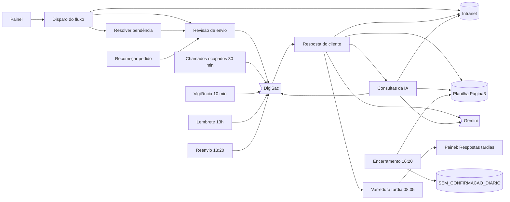

# Central Líder — servidor Flask

**Objetivo:** confirmar com o cliente, pelo WhatsApp (DigiSac), a data de entrega dos pedidos da Líder. É a migração do fluxo n8n **v28** para um servidor Python (Flask) que roda no computador do Mateus, com a **mesma operação**: mesmo painel, mesmos endereços `/webhook/...`, mesmas regras.

**Números:** 9 webhooks · 7 agendamentos (6 com horário + 1 ao ligar) · 6 tabelas SQLite · 6 integrações · 218 testes automáticos.

## Mapa

## Webhooks (o painel e o DigiSac chamam)
- [[Painel Central Líder]] — `GET /webhook/central-lider`
- [[Status do disparo]] — `GET /webhook/status-fluxo-lider`
- [[API Pendências]] — `GET /webhook/central-lider-pendencias`
- [[Disparo do fluxo]] — `POST /webhook/disparar-fluxo-lider`
- [[Resolver pendência]] — `POST /webhook/central-lider-resolver`
- [[Revisão de envio]] — `POST /webhook/central-lider-revisao`
- [[Resposta do cliente (DigiSac)]] — `POST /webhook/digisac-resposta`
- [[Consultas da IA (consultor)]] — `POST /webhook/central-lider-consultor`
- [[Recomeçar pedido]] — `POST /webhook/central-lider-recomecar`

## Agendamentos
- [[Chamados ocupados]] — a cada 30 min
- [[Varredura de vigilância]] — a cada 10 min
- [[Lembrete de confirmação 13h]] — seg-sex 13:00
- [[Reenvio do template]] — seg-sex 13:20
- [[Encerramento sem retorno]] — 16:20 seg-qui / 15:20 sex
- [[Varredura de respostas tardias]] — seg-sex 08:05 e 60 s depois de ligar

## Infraestrutura
- [[Rodar o servidor]] · [[Configuração (.env)]] · [[Modo teste]] · [[Banco SQLite]] · [[Integrações]]
- [[Logs e alertas]] · [[Endereço público (zrok)]] · [[Testes automáticos]] · [[Glossário de status]]

## Histórico
- [[Diario de bordo]] — todas as mudanças, mais recentes primeiro
- [[_Convencoes]] — como manter este vault
